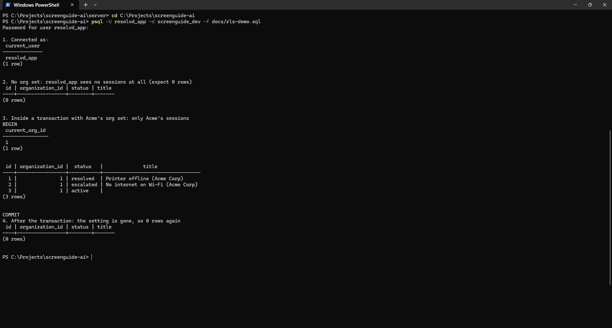

# ScreenGuide AI: Architecture

> Living document, started in Phase 0. Each phase fills in its section. The full specification is
> `SCREENGUIDE_PLAN.md`; this file describes what is actually built.

## Overview

ScreenGuide AI is a voice-first tech support assistant. The user shares their screen in the browser and
talks; the AI sees the screen, speaks back, highlights where to click and notices when each step is done.
It never controls the computer. Escalations become tickets that can be pushed into Resolvd, the sister
helpdesk app that ScreenGuide is designed to merge into later.

```
Browser (React on Vercel)
  ├─ REST  /api/*  ──(Vercel rewrite; Vite proxy in dev)──►  Express API (Render)
  └─ WebSocket /ws ──(direct to Render; Vite proxy in dev)─►    ├─ HTTP routes → services → queries
                                                                ├─ WebSocket session channels
                                                                ├─ pg-boss workers
                                                                └─ PostgreSQL (Neon): RLS, two roles
```

## Repository layout

| Path | What it is |
|---|---|
| `server/` | Express 5 API, JavaScript ES modules, raw SQL with `pg` |
| `server/db/setup/setup.sql` | One-time local setup: roles and databases (run as `postgres`) |
| `server/db/migrations/` | Numbered SQL migrations (Phase 1) |
| `server/src/` | `app.js` (`createApp()`), `server.js` (listen + shutdown), modules (Phase 2+) |
| `server/tests/` | Vitest + Supertest against a real PostgreSQL test database |
| `client/` | Vite + React (JSX), Mantine, TanStack Query, React Router, Zustand |
| `docs/` | Decisions, progress, architecture and protocol docs |
| `.github/workflows/ci.yml` | CI: server (Postgres 17 service) and client jobs |

## Local development topology

| Piece | Address | Notes |
|---|---|---|
| API | `http://127.0.0.1:4001` | Resolvd uses `localhost:4000` |
| Client (Vite) | `http://127.0.0.1:5174` | Resolvd uses `localhost:5173` |
| `/api`, `/ws` | proxied by Vite to `127.0.0.1:4001` | keeps cookies same-origin in dev |
| PostgreSQL | `localhost:5432` | locally installed (EDB), no Docker |

ScreenGuide runs on `127.0.0.1` and Resolvd on `localhost` because browsers don't separate cookies by
port: both apps use a cookie named `resolvd_token`, and different hosts keep them apart.

## Database roles

Exactly two roles, shared with Resolvd (cluster-wide in PostgreSQL):

- **`resolvd_owner`**: owns `screenguide_dev`, `screenguide_test` and (from Phase 1) every table. Runs
  migrations and seeds through `MIGRATION_DATABASE_URL`.
- **`resolvd_app`**: what the API connects as at runtime (`DATABASE_URL`). Owns nothing, so row-level
  security always applies to it. Only it and the owner can connect to the ScreenGuide databases.

`setup.sql` creates the roles only if they're missing and never changes an existing role's password, so
ScreenGuide and Resolvd can be set up on the same machine in either order.

## Database

PostgreSQL, raw SQL with `pg`, no ORM. Integer `SERIAL` ids, `TIMESTAMPTZ` timestamps.

### Migrations and the shared-shape rule

`server/scripts/migrate.js` (`npm run migrate`, as `resolvd_owner`) applies every numbered file in
`server/db/migrations/` that isn't yet recorded in `schema_migrations`, each in its own transaction
(`BEGIN` → SQL → record filename → `COMMIT`; `ROLLBACK` on error, so a failed file leaves no trace). An
advisory lock stops two runs overlapping.

| Files | Rule |
|---|---|
| `001`–`003`, `007` | **Copies of Resolvd's files** (`002`, `003` byte-identical; `001` and `007` leave out Resolvd-only types and tables). They only change when Resolvd's do, by copying. Tests pin the signatures, trigger names and grants. |
| `004`–`006` | Intentionally unused (Resolvd's tickets/categories/comments), so the histories line up. |
| `100`+ | ScreenGuide's own schema. **Never alters `organizations` or `users`**; extra org/user data lives in `org_settings` and `user_preferences`. At merge time only these move into Resolvd, renumbered. |

### Tables

| Table | Purpose | Notes |
|---|---|---|
| `organizations` | Tenants (shared with Resolvd) | RLS policy `org_self` (`id = current_org_id()`) |
| `users` | People (shared with Resolvd) | email unique across all orgs (`LOWER(email)`) |
| `org_settings` | Plan, retention, snapshots, IT contact, auto-push | one row per org |
| `user_preferences` | Voice, input mode, large text, consent | PK `(organization_id, user_id)` |
| `invitations` | Admin invites (hashed token) | one open invite per email per org |
| `assist_sessions` | One help session; the server's source of truth for session state | |
| `session_messages` | Transcript | cascade-deleted with the session |
| `session_steps` | Guided steps and outcomes | cascade-deleted with the session |
| `step_snapshots` | Optional downscaled JPEG per step (≤ 80 KB) | only when the org turns snapshots on |
| `escalation_tickets` | AI-written ticket + Resolvd push state | one per session |
| `session_feedback` | 1–5 rating | one per session |
| `usage_events` | Tokens, latency, TTS/STT usage per call | keeps its row (session_id cleared) when a session is deleted |
| `audit_events` | Append-only audit log | app role: `SELECT, INSERT` only |
| `integration_settings` | Resolvd connector (encrypted key) | one row per org |
| `idempotency_keys` | Stored responses for unsafe POSTs | purged after 24 h |
| `ws_tickets` | Single-use 60 s WebSocket tickets (hashed) | consumed by `consume_ws_ticket` |

Every tenant table has `organization_id INT NOT NULL REFERENCES organizations(id)`. Tables that others
reference have `UNIQUE (organization_id, id)`, and references are **composite foreign keys**
`(organization_id, x_id) → x (organization_id, id)`, so a row can never point at another org's row
even if application code makes a mistake. Tables with `updated_at` use the shared `set_updated_at()`
trigger.

### Row-level security

- `current_org_id()` reads the transaction-local setting `app.current_org_id` (set by `withOrg` in
  Phase 2 with `set_config(..., true)`) and returns `NULL` when it isn't set.
- Every tenant table has RLS enabled and the policy **`org_isolation`**:
  `USING (organization_id = current_org_id()) WITH CHECK (organization_id = current_org_id())`.
- With no org set, `resolvd_app` sees **zero rows** everywhere; inside a transaction with an org set it
  sees only that org's rows, and can't insert or move rows into another org.
- `resolvd_owner` owns the tables, so RLS doesn't apply to it (RLS isn't `FORCE`d). That is why the API
  never connects as the owner.



To reproduce: `psql -U resolvd_app -d screenguide_dev -f docs/rls-demo.sql` after `npm run migrate` and
`npm run seed`.

### SECURITY DEFINER functions

A few operations must happen before an org is known, or deliberately across orgs. They run as the
owner (bypassing RLS) through narrow functions. Each one uses `SET search_path = public` and
`REVOKE ALL ... FROM PUBLIC`, and grants `EXECUTE` only to `resolvd_app`. A test enforces this for every
definer function.

| Function | Why it needs to bypass RLS |
|---|---|
| `auth_find_user_by_email(p_email)` | Login: the org isn't known until the user is found (returns Resolvd's 7 columns) |
| `auth_record_login_failure(p_user_id, p_max_attempts, p_lock_minutes)` | Login lockout: saves the failed attempt (and the 15-minute lock at 5) outside any transaction that rolls back; `RETURNS VOID` |
| `create_organization(p_name, p_slug)` | Registration: the org doesn't exist yet |
| `accept_invitation(token_hash, name, password_hash)` | The invitee isn't signed in to any org |
| `consume_ws_ticket(token_hash)` | WebSocket upgrade: atomic single use, before the org is known |
| `purge_expired_sessions()` | Daily retention job, across all orgs |
| `purge_idempotency_keys(max_age)` | Hourly cleanup, across all orgs |
| `purge_expired_ws_tickets()` | Cleanup of old tickets, across all orgs |

### Seeds

`npm run seed` (as the owner) resets the database: it truncates every organization's data, then
creates **Acme Corp** (`acme-corp`) and **Globex** (`globex`). The orgs and users are the same as
Resolvd's seed (`server/db/seeds/users.js`, a copy of Resolvd's): each org has 1 admin, 2 technicians
and 3 end users, keyed as `USERS.acme.tech1` and so on. Every user signs in with `SEED_PASSWORD` from
`server/.env`. ScreenGuide adds settings, preferences, a resolved session with feedback, an escalated
session with a ticket, an active session, and at least one row in every other tenant table. The code
is in `scripts/lib/seed.js`; `scripts/seed.js` is the runner. It refuses to run in production.

### Tests

`npm test` always uses `screenguide_test`. Its URL comes from your `.env` with the database name swapped,
so tests can't touch dev data. `tests/globalSetup.js` drops and recreates the test schema, migrates and
seeds it. `migrations.test.js` checks the catalog (RLS + `org_isolation` on every table with
`organization_id`, definer-function hardening, that `resolvd_app` owns nothing, and `updated_at`
triggers), so new tables are covered automatically. `rls.test.js` is the isolation acceptance test.

## HTTP request lifecycle

`src/app.js` exports `createApp()`; `src/server.js` listens, starts the job queue and handles
shutdown. Every request passes through, in order:

1. **`requestId`**: reuses a valid UUID from `X-Request-Id` or generates one, then sets `req.id` and
   the `X-Request-Id` response header.
2. **helmet** (security headers, default CSP) → **cors** (only `CLIENT_ORIGIN`, with credentials).
3. **pino-http**: logs every request; `req.log` is bound to `requestId`, so every line logged while
   handling a request carries the id. Cookies, auth headers, passwords, API keys, frames, audio and
   message content are redacted.
4. **`express.json({ limit: '100kb' })`** → **cookie-parser** → **general rate limit** (300/min per IP
   on `/api`).
5. **Routes**: `authenticate` → `requireRole` → `validate({ body, params, query })` → (`idempotent()` on
   unsafe POSTs) → controller → service → queries.
6. **`notFound`** → **`errorHandler`**: everything becomes `{ error: { code, message, details? } }`.

### Layers

| Layer | Does | Doesn't |
|---|---|---|
| Route (`*.routes.js`) | Wires middleware and `validate()` to a controller | Any logic |
| Controller | Reads `req`, calls one service function, sends the response | Business rules, SQL |
| Service | Business rules; opens `withOrg(orgId, client => ...)`; writes audit rows and enqueues jobs on the same `client` | Know about HTTP |
| Queries | Plain parameterized SQL taking `client` as the first argument | Open transactions |

### Database helpers (`src/db/withOrg.js`)

- `withTransaction(work)`: `BEGIN` → `work(client)` → `COMMIT`; `ROLLBACK` on error; always releases the
  client.
- `setOrg(client, orgId)`: `set_config('app.current_org_id', orgId, true)`, valid for this transaction
  only.
- `withOrg(orgId, work)`: both together. RLS then limits every query on that client to the org.

### Errors

Services throw `AppError` (`status`, `code`, `message`, `details`). The error handler follows the same
rules as Resolvd's:

- any `ZodError` → 400 `VALIDATION_ERROR` with `details` = `{ formErrors, fieldErrors }` (Zod's
  flattened error);
- PostgreSQL `23505` → 409 `CONFLICT`, `23503` → 400 `INVALID_REFERENCE`, `22P02` → 400
  `INVALID_INPUT`;
- unknown routes → 404 `NOT_FOUND`.

ScreenGuide also handles bad JSON (400 `INVALID_JSON`) and oversized bodies (413), which Resolvd will
adopt. Anything unexpected is logged with the request id and answered with a generic 500
`INTERNAL_ERROR`, so no internals leak. Internal validation (audit events, job payloads) throws a plain
`Error`, not a `ZodError`, so a bug in our own code shows as a 500, not as the client's fault.

### Health, readiness and docs

- `GET /api/health`: Resolvd's contract. It runs `SELECT 1` and returns 200
  `{ status: 'ok', database: 'up' }`, or 503 `{ status: 'degraded', database: 'down' }`. Render's health
  check points here.
- `GET /api/ready` (ScreenGuide addition): `{ status, database, jobs }`, 503 `degraded` if either is
  down. Each check times out after 2 s.
- `GET /api/docs`: Swagger UI for `server/openapi.yaml`; `GET /api/docs/openapi.json` serves the raw
  document.

### Idempotency, audit and secrets

- **`idempotent()`** (unsafe POSTs): needs an `Idempotency-Key` UUID. It claims the key in its own short
  transaction, stores the JSON response for 2xx and business-logic 4xx (e.g. 404, 409), and replays it
  for repeats. A different body with the same key gets 422, and a duplicate while the first request is
  still running gets 409. 5xx, 400 `VALIDATION_ERROR`, 401, 403 and 429 aren't stored: the key is
  released, so a retry with the same key runs fresh.
- **`recordAudit(client, event)`** writes to `audit_events` on the caller's transaction client, so the
  audit row commits or rolls back with the change. Only the actions in `AUDIT_ACTIONS` are accepted.
- **`src/utils/crypto.js`**: AES-256-GCM with `ENCRYPTION_KEY`, stored as `iv:authTag:ciphertext`.

## Jobs (pg-boss)

- **Schema:** `pgboss`, installed by migration `112_pgboss.sql` as `resolvd_owner`. It's generated from
  pg-boss's own plans by `scripts/generate-pgboss-migration.js`, which also writes upgrade migrations
  after a pg-boss bump. pg-boss tables aren't tenant tables, so they have no RLS.
- **Runtime:** pg-boss connects as `resolvd_app` with `migrate: false` (it only checks the schema
  version) and `reindex: false`, using DML-only grants. There's no third role.
- **`createJobs()`** (`src/jobs/index.js`) creates the queues from `queues.js` and registers the workers
  from `workers/`. It also provides `isUp()` for `/api/ready` and `stop()` for shutdown.
- **Enqueue in the same transaction:** `jobs.send(name, data, { client })` runs pg-boss's `INSERT` on
  the `withOrg` client, so the job exists only if the data change commits.
- **Payloads** always include `orgId` and `requestId` (validated). Workers log with both, do tenant work
  inside `withOrg(job.data.orgId, ...)`, and must be safe to run twice.
- **Shutdown:** stop accepting HTTP → `jobs.stop()` (running jobs get 10 s) → `pool.end()`.

## Sections to come

- **Auth** (Phase 3).
- **Real-time** (Phase 5): WebSocket ticket auth, session channels (see `docs/ws-protocol.md`).
- **AI engine and voice** (Phases 6–7).
- **Deployment** (Phase 11): Render, Neon, Vercel.
